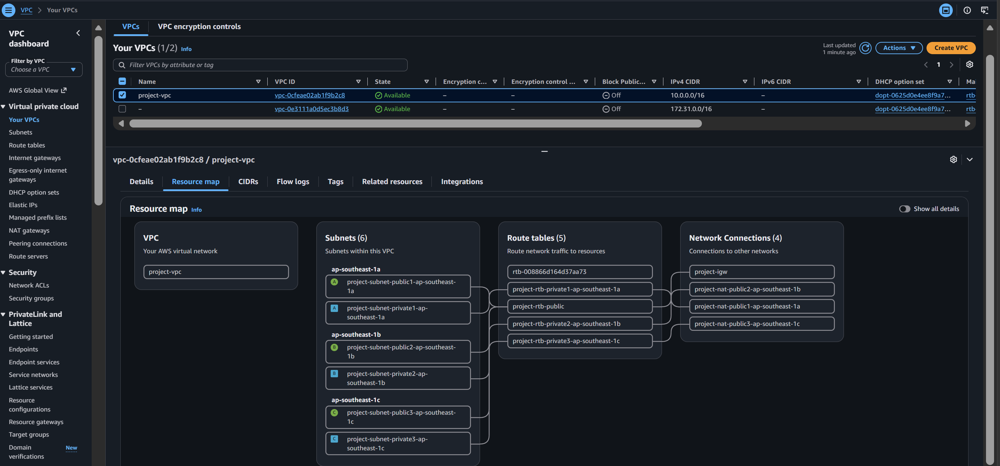
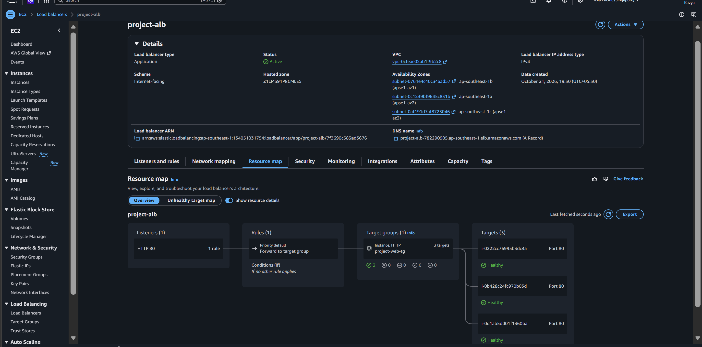
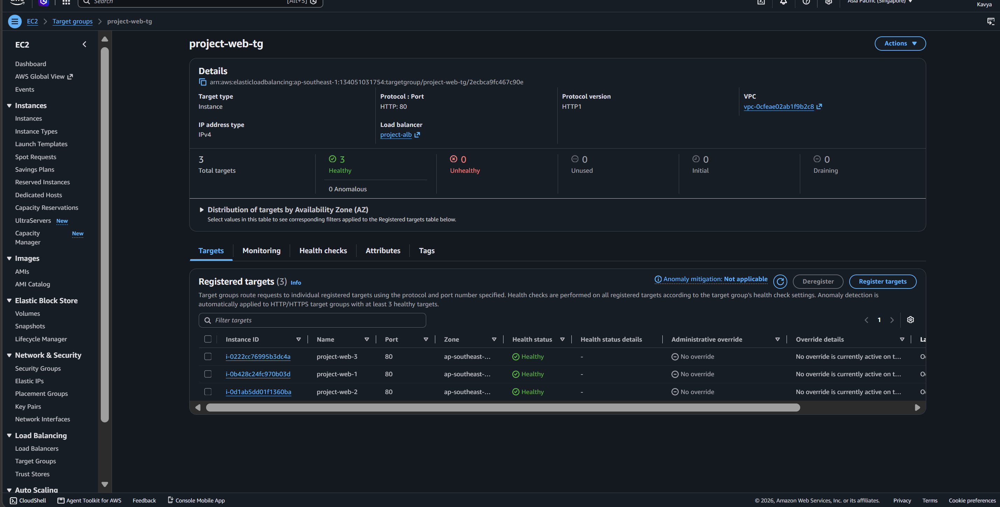
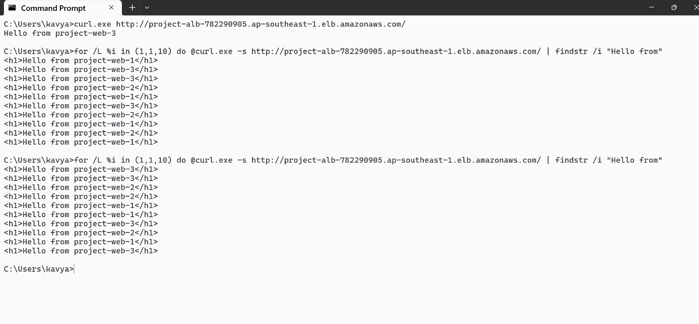

# AWS Highly Available Web Architecture

A cloud infrastructure project built using Amazon Web Services (AWS), featuring a custom VPC, public and private subnets across three Availability Zones, NAT Gateways, private EC2 instances, and an Application Load Balancer.

## Project Overview

This project demonstrates how to deploy a web application on AWS using a segmented network architecture. Three Ubuntu EC2 instances run Nginx web servers in private subnets. An internet-facing Application Load Balancer distributes incoming HTTP requests to healthy registered targets.

Each web server serves a custom HTML page to help identify which backend instance responds to a request.

## Architecture

```text
                         Internet
                            |
                    Internet Gateway
                            |
               Application Load Balancer
                        HTTP : 80
                            |
                     Target Group
                            |
             +--------------+--------------+
             |              |              |
          EC2 Web 1      EC2 Web 2      EC2 Web 3
          Nginx : 80     Nginx : 80     Nginx : 80
             |              |              |
          Private         Private        Private
          Subnet          Subnet         Subnet
          AZ 1a           AZ 1b          AZ 1c
```

## AWS Services Used

- Amazon VPC
- Public and private subnets
- Internet Gateway
- NAT Gateways
- Route tables
- Amazon EC2 with Ubuntu Linux
- Nginx web server
- Application Load Balancer (ALB)
- Target group and health checks
- Security groups and Network ACLs
- AWS Systems Manager

## Network Configuration

| Component | Configuration |
|---|---|
| AWS Region | `ap-southeast-1` (Singapore) |
| VPC CIDR | `10.0.0.0/16` |
| Public subnets | 3 |
| Private subnets | 3 |
| Availability Zones | 3 |
| EC2 web servers | 3 |
| ALB listener | HTTP port 80 |
| Target group | `project-web-tg` |
| Health check path | `/` |

## Screenshots

### 1. VPC Resource Map

Shows the VPC networking layout and subnet organization.



### 2. Application Load Balancer Listener

Shows the load balancer listener and traffic forwarding configuration.



### 3. Target Group Health

Shows the registered EC2 instances and their health status.



### 4. Website Testing

Shows the web application test result through the load balancer.



## Testing and Validation

The Application Load Balancer endpoint was tested using Windows Command Prompt and `curl.exe`.

```cmd
curl.exe -v --connect-timeout 10 http://project-alb-782290905.ap-southeast-1.elb.amazonaws.com/
```

**Observed result:** HTTP `200 OK`

Additional validation included:

- Configuring custom HTML pages on the three Nginx servers.
- Checking the target group health status.
- Testing HTTP connectivity through the load balancer.
- Troubleshooting an initial connection timeout.

## Key Learnings

- VPC networking and subnet CIDR design
- Public and private route tables
- Internet Gateway and NAT Gateway configuration
- Ubuntu EC2 instance administration
- Nginx web server configuration
- Application Load Balancer and target group setup
- Health checks and connectivity troubleshooting
- AWS security groups and Network ACLs

## Future Improvements

- Infrastructure as Code using Terraform
- EC2 Auto Scaling
- HTTPS using AWS Certificate Manager
- CloudWatch monitoring and alarms
- Automated deployment using CI/CD pipelines
- Improved least-privilege security rules

## Cost Considerations

AWS resources such as EC2 instances, NAT Gateways, load balancers, and public IPv4 addresses may incur charges. Review and remove unused resources when the project is no longer required.

## Detailed Documentation

See [Project Documentation](docs/project-documentation.md) for detailed configuration, testing, and troubleshooting information.

## Author

**Kavya Mane**

GitHub: [@kavyamane](https://github.com/kavyamane)

Project Repository: [aws-high-availability-architecture](https://github.com/kavyamane/aws-high-availability-architecture)
